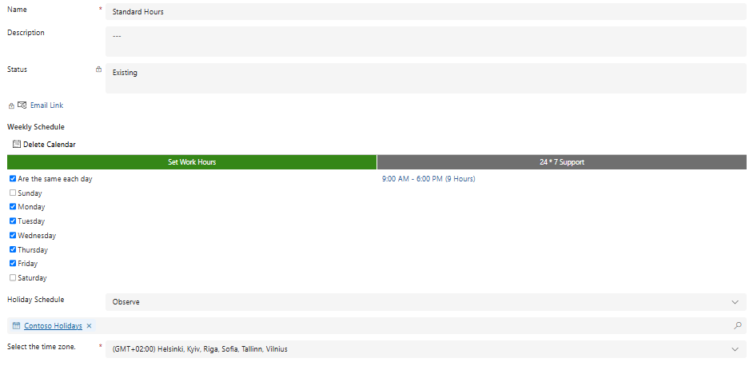
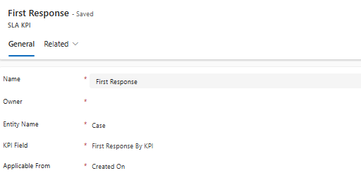
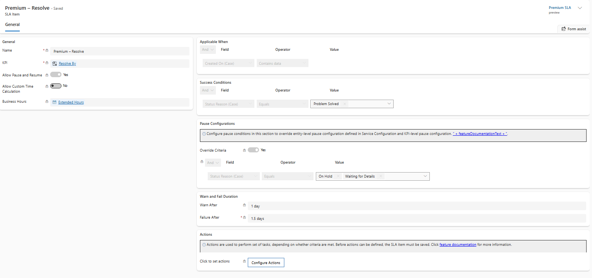
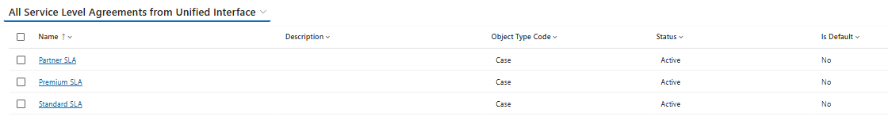
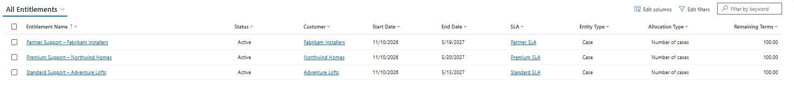
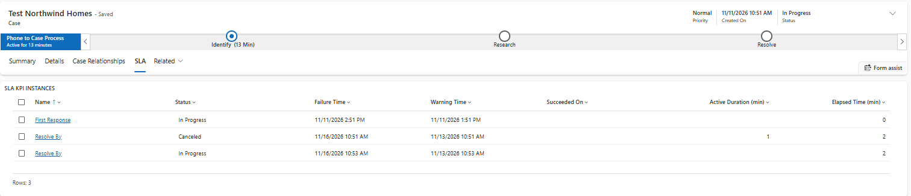
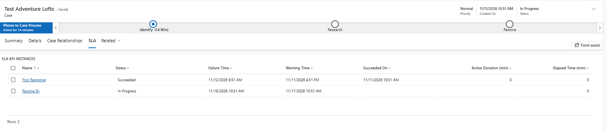
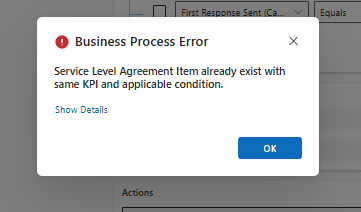

# SLA in Dynamics 365 Customer Service (Contoso Support)

> Draft. Built and tested in a live trial on 2026-11-10/11. Field and menu names may differ slightly by release; verify against Microsoft Learn.

## Goal
Three service tiers with First Response and Resolve targets, measured in business hours, paused while a case waits for the customer.

## Prerequisites
- Environment from [01-environment-setup](../01-environment-setup.md); "Enable calendar export and import" is on.
- Roles: System Administrator or CSR Manager.

## Design

### Calendars (Operations > Calendar)
| Calendar | Hours | Holidays | Status |
|---|---|---|---|
| Standard Hours | Mon-Fri 09:00-18:00 (9 h/day) | Observe `Contoso Holidays` | done |
| Extended Hours | Mon-Fri 08:00-20:00 (12 h/day) | Observe `Contoso Holidays` | done |
| Always On | 24x7 | Observe `Contoso Holidays` | done |

Time zone: same for all three (Kyiv, GMT+02:00). Holiday schedule `Contoso Holidays`: New Year 1 Jan 2026 and 1 Jan 2027.

### SLA KPIs (Operations > Service terms)
| KPI | Entity | KPI field | Applicable from | Status |
|---|---|---|---|---|
| First Response | Case | First Response By KPI | Created On | active |
| Resolve By | Case | Resolve By KPI | Created On | active |

### SLAs and SLA items
Failure and warning durations are counted in the working hours of the selected calendar. Resolve durations below are business days converted to hours of that calendar.

| SLA | Item | KPI | Calendar | Failure | Warning | Pause and resume | Status |
|---|---|---|---|---|---|---|---|
| Standard SLA | Standard - First Response | First Response | Standard Hours | 8 h | 6 h | No | active, tested |
| Standard SLA | Standard - Resolve | Resolve By | Standard Hours | 45 h (5 days x 9 h), shown in the form as 1.88 days | 36 h, shown as 1.5 days | Yes (on hold: On Hold, Waiting for Details) | active, tested |
| Premium SLA | Premium - First Response | First Response | Extended Hours | 4 h | 3 h | No | active, tested |
| Premium SLA | Premium - Resolve | Resolve By | Extended Hours | 36 h (3 days x 12 h), shown as 1.5 days | 24 h, shown as 1 day | Yes (On Hold, Waiting for Details) | active, tested |
| Partner SLA | Partner - First Response | First Response | Always On | 1 h | 45 min | No | active, tested |
| Partner SLA | Partner - Resolve | Resolve By | Always On | 24 h (shown as 1 day) | 18 h | Yes (On Hold, Waiting for Details) | active, tested |

One SLA per tier. Adding a second item with the same KPI and the same Applicable When condition to one SLA fails with "Service Level Agreement Item already exist with same KPI and applicable condition"; do not create extra KPIs, create a separate SLA instead.

Common settings on every item:
- Applicable When: a field that does not change after creation (avoid frequently updated fields; a change can cancel the SLA item).
- Applicable When used in the demo: Created On (Case) contains data.
- Success condition: First Response = First Response Sent equals Yes; Resolve = Status Reason equals Problem Solved (consider adding Information Provided).
- Allow Custom Time Calculation: No.
- The form shows durations in days of 24 hours (1.88 days = 45 h of business hours); the time is counted against the item's calendar.

### Pause settings
Two ways to define "on hold":
1. Entity level: Service terms > Other SLA settings > Manage > Service Configuration Settings.
2. On the SLA item: Pause Configurations > Override Criteria = Yes (used in this demo): Status Reason equals On Hold or Waiting for Details. This overrides the entity-level and KPI-level settings.

### Applying the SLAs
Only one SLA can be applied to a case. Order of lookup (Learn): SLA applied automatically (flow/plug-in), then through the case's entitlement, then the default SLA. Used here: one entitlement per tier, set on the case; no default SLA.

### Verified result (2026-11-11)
All three SLAs and three entitlements (one per tier, 100 cases each, valid about 6 months) are Active. Test case for the Partner account, created 08:42, with the Entitlement selected on the case:

| KPI | Warning | Failure |
|---|---|---|
| First Response | 09:27 (+45 min) | 09:42 (+1 h) |
| Resolve By | 02:42 next day (+18 h) | 08:42 next day (+24 h) |

Both KPI instances were In Progress. Times match the Always On calendar.

Test cases for the other tiers (one case per account, entitlement set on the case):

| Tier | Check | Result |
|---|---|---|
| Standard | First Response Sent = Yes | KPI Succeeded immediately |
| Standard | Resolve By, case created Wed 08:51 | warning Tue 17 Nov, failure Wed 18 Nov (36 h / 45 h of Mon-Fri business hours, weekend skipped) |
| Premium | First Response | warning +3 h, failure +4 h |
| Premium | Status Reason = Waiting for Details | Resolve By = Paused |
| Premium | Back to In Progress | old Resolve By = Canceled, new one In Progress; failure and warning shifted by the paused time (about 2 min) |
| Premium | Resolve By, created Wed | warning Fri (24 h), failure Mon (36 h): weekend skipped |

Time zone: the SLA calendars are in Kyiv time. With the user's time zone set to UTC the times looked 2 hours off the calendar hours; set Personal Settings > Time zone to the calendar's zone before reading or screenshotting timers.

## Screenshots
| | |
|---|---|
| Calendar `Standard Hours` |  |
| SLA KPI `First Response` |  |
| SLA item `Premium - Resolve` |  |
| Three active SLAs |  |
| Three active entitlements |  |
| Pause and resume: old Resolve By canceled, new one started |  |
| First Response succeeded, Resolve By in progress (Standard) |  |
| Duplicate KPI in one SLA |  |

## Gotchas
- The entitlement was not filled in automatically on a new case: the SLA KPI Instances stayed empty until the Entitlement field was set manually on the case and saved. Check the case's Customer (the account) and the Entitlement field first when no SLA applies.
- First activation of an SLA failed with a Flow error (`CdsInstanceNotReady`) on a fresh trial; it passed on retry after the environment finished provisioning and Dataverse connections existed.
- "Allow Pause and Resume" cannot be changed after the SLA item is first saved.
- Pause then resume cancels the SLA KPI instance and creates a new one.
- Editing an active SLA item by hand creates an active-layer change that later solution upgrades do not override; change SLAs through solution upgrades.
- Importing a solution with SLAs into an org that already has active SLAs: deactivate them first; with "Overwrite customizations" they come back as Draft.
- Business hours not set on an SLA item = 24x7 calculation.
- Do not customize the SLA, SLA KPI and SLA item forms.

## Links
- https://learn.microsoft.com/dynamics365/customer-service/administer/define-service-level-agreements
- https://learn.microsoft.com/dynamics365/customer-service/administer/create-customer-service-schedule-define-work-hours
- https://learn.microsoft.com/dynamics365/customer-service/administer/set-up-holiday-schedule
- https://learn.microsoft.com/dynamics365/customer-service/administer/manage-solution
- https://learn.microsoft.com/dynamics365/customer-service/administer/export-import-solution

_Verified on: 2026-11-10 (calendars and KPIs in a live trial; the rest from documentation)_
