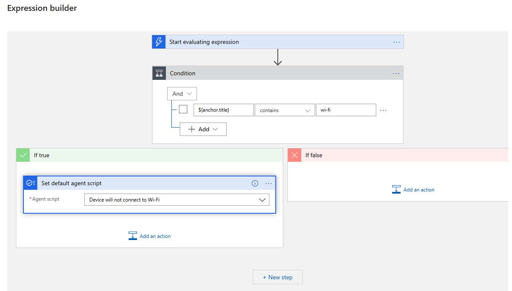
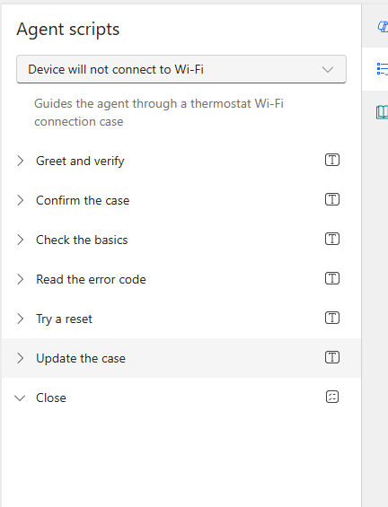

# Agent Scripts in Dynamics 365 Customer Service (Contoso Support)

> Draft. First script built and tested in a live trial on 2026-11-13. Field and menu names may differ slightly by release; verify against Microsoft Learn.

## Goal
Guide a service agent step by step through a recurring case type, inside the Customer Service workspace, without leaving the case.

## Prerequisites
- Environment from [01-environment-setup](../01-environment-setup.md).
- Roles: Productivity tools administrator or System Administrator to design; agents need Productivity tools user or Customer Service representative.
- A session template for case sessions (this demo uses `Case Session Trial Template`).

## Design

### Script 1: Device will not connect to Wi-Fi
| Field | Value |
|---|---|
| Name | Device will not connect to Wi-Fi |
| Unique Name | `contoso_wifi` (prefix 3-8 alphanumeric characters, underscore, then name) |
| Language | English |

| # | Step | Unique name | Type | Instruction |
|---|---|---|---|---|
| 1 | Greet and verify | `contoso_wifi_greet` | Text | Greet the customer and confirm the account name and the device serial number. |
| 2 | Confirm the case | `contoso_wifi_case` | Text | Read back the case title: `${anchor.title}` and confirm it matches the problem. |
| 3 | Check the basics | `contoso_wifi_basics` | Text | Ask: router band (2.4 GHz), password, distance, other devices. |
| 4 | Read the error code | `contoso_wifi_code` | Text | Ask for the code on the display or in the app and search the knowledge base. |
| 5 | Try a reset | `contoso_wifi_reset` | Text | Hold the button for 10 seconds, then pair again from the app. |
| 6 | Update the case | `contoso_wifi_update` | Text | Set case type and priority, note what was tried. |
| 7 | Close | `contoso_wifi_close` | Script | Loads the shared script `contoso_closing`. |

Shared sub-script `contoso_closing` ("Close the case", Text steps): Summarise (`contoso_closing_sum`), Confirm the next steps (`contoso_closing_next`), Agree the follow-up time (`contoso_closing_follow`). Other scripts can reuse it, so a change to the closing steps is made once.

Planned: scripts for warranty replacement and installation complaint; a macro step (for example open the case form) after the text steps.

## Steps
1. Copilot Service admin center > Support experience > Productivity > Scripts > New. Fill Name, Unique Name, Language, Description; Save.
2. In Script steps, New Script step for each row: Name (shown to the agent), Unique Name, Order, Action Type (Text instruction, Macro or Script), instruction text. Save and Close each, then Save the script.
3. Add the script to the session template: open the Session template > Scripts tab > Add Existing Script. A script is not shown on the form until it is in the template of that session type.
4. Optional, default script: on the same tab set "Enable build expression" to Yes > Build expression. In Condition type the slug as plain text in the first field (`${anchor.title}`, with the dollar sign and braces), operator `contains`, value `wi-fi`. In "If true" > Add an action > Customer Service > "Set default agent script" and pick the script. Save and close, then Save the template. The condition fields are text boxes, so the Dynamic content panel stays empty; that is normal.

## Result
Default script: a case whose title contains "wi-fi" opens with the Wi-Fi script already selected (after a browser refresh).

Verified in Customer Service workspace: opening a case shows the Agent scripts pane in the Productivity panel; the script list lets the agent switch between scripts; `${anchor.title}` is replaced with the case title; steps can be expanded and marked done.

## Screenshots
| | |
|---|---|
| Default script condition |  |
| Script in the Agent scripts pane |  |
| Sub-script loaded from step 7 |  |
| Switching scripts |  |

## Gotchas
- A Script step loads the other script into the pane in place of the current one. There is no "back" button; the agent returns to the main script through the script list (trial). Keep sub-scripts short.
- The sub-script must be added to the same Session template, otherwise it is not found and not listed.
- A script must be added to the Session template before it appears on the form (trial).
- Step instructions use slugs. In Copilot Service workspace only the `${anchor.<attribute_name>}` slug is supported in scripts and macros; `${customerName}` and similar are for conversations.
- Unique name format: prefix 3-8 alphanumeric characters, an underscore, then the name. A wrong prefix blocks saving.
- Reload the workspace and reopen the case after changing the template (sessions load their template at start). In the trial the default script only switched after a full browser refresh.
- Default script by expression (trial): `${anchor.title}` contains `wi-fi` worked. The plain `anchor.title` (without `${}`) did not select the script, and a value with capital letters (`Wi-Fi`) did not either. Use the full slug and a lowercase value and test on a case. Learn describes this feature for incoming conversations, so check it on your own session type.

## Links
- https://learn.microsoft.com/dynamics365/customer-service/administer/agent-scripts
- https://learn.microsoft.com/dynamics365/customer-service/administer/automation-dictionary-keys
- https://learn.microsoft.com/dynamics365/customer-service/administer/macros
- https://learn.microsoft.com/dynamics365/customer-service/use/oc-agent-scripts

_Verified on: 2026-11-13 (script, session template and slug in a live trial; slug rules from documentation)_
