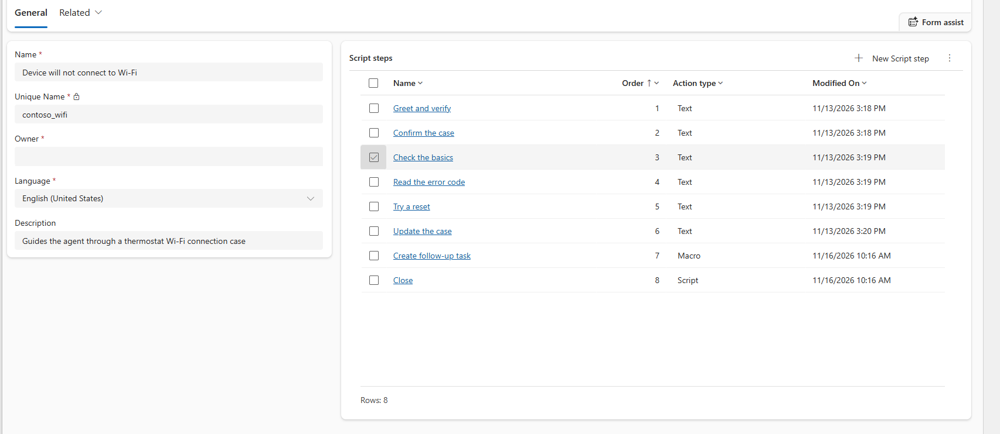
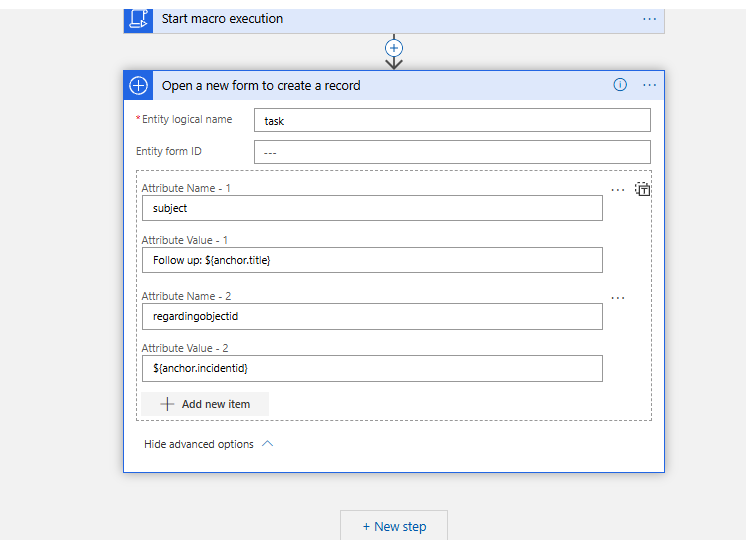
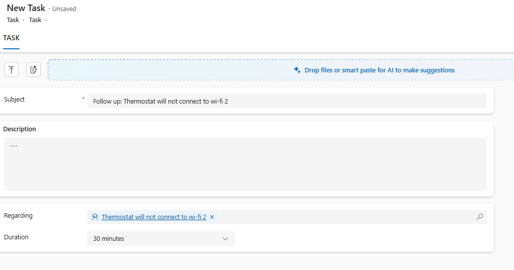
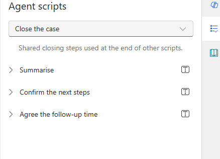
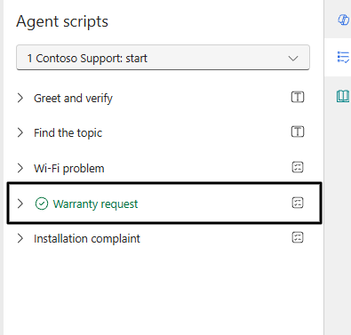
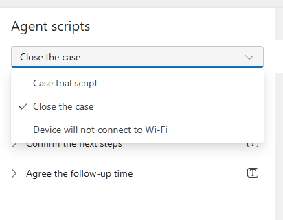

# Agent Scripts in Dynamics 365 Customer Service (Contoso Support)

> Draft. First script built and tested in a live trial on 2026-11-13. Field and menu names may differ slightly by release; verify against Microsoft Learn.

## Goal
Guide a service agent step by step through a recurring case type, inside the Customer Service workspace, without leaving the case.

## Prerequisites
- Environment from [01-environment-setup](../01-environment-setup.md).
- Roles: Productivity tools administrator or System Administrator to design; agents need Productivity tools user or Customer Service representative.
- A session template for case sessions (this demo uses `Case Session Trial Template`).

## Design

One root script, three topic (child) scripts and one shared closing script. A Script step loads another script into the pane, so the tree is built from Script steps.

```
contoso_start  "Contoso Support: start"   (root, default for cases without a topic)
 |- contoso_wifi      Device will not connect to Wi-Fi
 |- contoso_warranty  Warranty replacement request
 |- contoso_install   Installation complaint
 `- contoso_closing   Close the case (shared; its last step goes back to the root)
```

Unique names: prefix 3-8 alphanumeric characters, an underscore, then the name.

Script names carry a numeric prefix so the script list in the pane sorts in tree order: `1 Contoso Support: start`, `2.1 Device will not connect to Wi-Fi`, `2.2 Warranty replacement request`, `2.3 Installation complaint`, `3 Close the case`. Unique names stay unchanged.

### Root: Contoso Support: start (`contoso_start`)
| # | Step | Type | Instruction / target |
|---|---|---|---|
| 1 | Greet and verify | Text | Greet the customer, confirm the account and the device serial number. |
| 2 | Find the topic | Text | Ask what the problem is, then open the matching script below. |
| 3 | Wi-Fi problem | Script | `contoso_wifi` |
| 4 | Warranty request | Script | `contoso_warranty` |
| 5 | Installation complaint | Script | `contoso_install` |

### Child: Device will not connect to Wi-Fi (`contoso_wifi`)
| # | Step | Type | Instruction / target |
|---|---|---|---|
| 1 | Confirm the case | Text | Read back the case title: `${anchor.title}` and confirm it matches the problem. |
| 2 | Check the basics | Text | Ask: router band (2.4 GHz), password, distance, other devices. |
| 3 | Read the error code | Macro | `Search knowledge` |
| 4 | Try a reset | Text | Hold the button for 10 seconds, then pair again from the app. |
| 5 | Update the case | Text | Set case type and priority, note what was tried. |
| 6 | Create follow-up task | Macro | `Create follow-up task` |
| 7 | Close | Script | `contoso_closing` |

### Child: Warranty replacement request (`contoso_warranty`)
| # | Step | Type | Instruction / target |
|---|---|---|---|
| 1 | Check the warranty | Macro | `Open the product` |
| 2 | Confirm the purchase | Text | Ask for the purchase date and the invoice; compare with the warranty period. |
| 3 | Understand the fault | Text | Ask what is wrong, when it started and whether the device was moved or repaired. |
| 4 | Decide the outcome | Text | Within warranty and no misuse: approve a replacement. Otherwise explain the options. |
| 5 | Plan the follow-up | Macro | `Create follow-up task` |
| 6 | Close | Script | `contoso_closing` |

### Child: Installation complaint (`contoso_install`)
| # | Step | Type | Instruction / target |
|---|---|---|---|
| 1 | Acknowledge | Text | Listen without interrupting, apologise, confirm the contact details. |
| 2 | Collect the facts | Text | Ask for the installer, the date and the site, and what was done wrongly. |
| 3 | Ask for evidence | Text | Ask for photos or the installation report and attach them to the case. |
| 4 | Set the priority | Macro | `Set priority High` (only if the device is unsafe or not working) |
| 5 | Hand over | Text | Route the case to the Partner Desk queue and tell the customer the response time. |
| 6 | Close | Script | `contoso_closing` |

### Shared: Close the case (`contoso_closing`)
| # | Step | Type | Instruction / target |
|---|---|---|---|
| 1 | Summarise | Text | Summarise what was done and what the customer should expect. |
| 2 | Confirm the next steps | Text | Confirm who does what next and by when. |
| 3 | Agree the follow-up time | Text | Agree a follow-up date and time and note it in the case. |
| 4 | Back to start | Script | `contoso_start` |

### Macros (Productivity > Macros)
Every macro starts with the action "Start macro execution".

| Macro | Action and parameters | Used in |
|---|---|---|
| Create follow-up task | Open a new form to create a record: entity `task`; `subject` = `Follow up: ${anchor.title}`; `regardingobjectid` = `${anchor.incidentid}`; `regardingobjectidtype` = `incident`; `regardingobjectidname` = `${anchor.title}` | Wi-Fi, Warranty |
| Search knowledge | Search the knowledge base for the populated phrase: Tab Label `Searching for ${anchor.title}`, Search string `${anchor.title}` | Wi-Fi |
| Open the product | Open an existing record: entity `product`, record ID `${anchor._productid_value}` | Warranty |
| Set priority High | Update an existing record: entity `incident`, record ID `${anchor.incidentid}`, `prioritycode` = `1` | Install |

A lookup in "Open a new form to create a record" needs all three attributes (id, type, name). With only the id, the form assumes the lookup type is `account` and fails with "Record Is Unavailable".

## Steps
1. Copilot Service admin center > Support experience > Productivity > Scripts > New. Fill Name, Unique Name, Language, Description; Save.
2. In Script steps, New Script step for each row: Name (shown to the agent), Unique Name, Order, Action Type (Text instruction, Macro or Script), instruction text. Save and Close each, then Save the script.
3. Add the script to the session template: open the Session template > Scripts tab > Add Existing Script. A script is not shown on the form until it is in the template of that session type.
4. Optional, default script: on the same tab set "Enable build expression" to Yes > Build expression. In Condition type the slug as plain text in the first field (`${anchor.title}`, with the dollar sign and braces), operator `contains`, value `wi-fi`. In "If true" > Add an action > Customer Service > "Set default agent script" and pick the Wi-Fi script; in "If false" set the root script `contoso_start` as default. Save and close, then Save the template. The condition fields are text boxes, so the Dynamic content panel stays empty; that is normal.

## Result
Tested in Customer Service workspace on 2026-11-16:
- A case without a topic in the title opens the root script `1 Contoso Support: start`; a case whose title contains "Wi-Fi" opens the Wi-Fi script (after a browser refresh).
- Root > Warranty request > Check the warranty opens the product form; Plan the follow-up opens the Task form with Subject and Regarding filled.
- Install > Set the priority sets the case priority to High; Wi-Fi > Read the error code opens the knowledge search with the case title.
- Close the case > Back to start returns to the root script.

Verified in Customer Service workspace: opening a case shows the Agent scripts pane in the Productivity panel; the script list lets the agent switch between scripts; `${anchor.title}` is replaced with the case title; steps can be expanded and marked done.

## Screenshots
| | |
|---|---|
| Script steps in the admin center (Text, Macro, Script) |  |
| Macro `Create follow-up task` |  |
| Task form opened by the macro, with Subject and Regarding filled |  |
| Default script condition |  |
| Script in the Agent scripts pane |  |
| Sub-script loaded from step 7 |  |
| Root script with a child script step marked as done |  |
| Switching scripts |  |

## Gotchas
- After changing scripts, macros or the session template, refresh the browser page (Ctrl+F5) and reopen the case. In the trial, macros did not pick up case data (the product and task forms stayed empty) until the page was refreshed, and the new default script applied only after a refresh.
- Script progress is kept per page load: after a browser refresh all steps are unchecked again and the script list returns to the default script (the root script).
- Macro lookups (for example Regarding) need the id, the type and the name as three separate attributes; the id alone is read as an account.
- Keep macro descriptions clean: text pasted into the Description field is saved with the macro and ends up in the solution.
- A Script step loads the other script into the pane in place of the current one. There is no "back" button; the agent returns to the main script through the script list (trial). Keep sub-scripts short.
- The sub-script must be added to the same Session template, otherwise it is not found and not listed.
- A script must be added to the Session template before it appears on the form (trial).
- Step instructions use slugs. In Copilot Service workspace only the `${anchor.<attribute_name>}` slug is supported in scripts and macros; `${customerName}` and similar are for conversations.
- Unique name format: prefix 3-8 alphanumeric characters, an underscore, then the name. A wrong prefix blocks saving.
- Reload the workspace and reopen the case after changing the template (sessions load their template at start). In the trial the default script only switched after a full browser refresh.
- Default script by expression (trial): `${anchor.title}` contains `wi-fi` worked. The plain `anchor.title` (without `${}`) did not select the script, and a value with capital letters (`Wi-Fi`) did not either. Use the full slug and test on a case. The match looks case-sensitive, so the builder uses an Or condition with both `wi-fi` and `Wi-Fi` (see the root-script screenshot); not yet verified on every title variant. Learn describes this feature for incoming conversations, so check it on your own session type.

## Links
- https://learn.microsoft.com/dynamics365/customer-service/administer/agent-scripts
- https://learn.microsoft.com/dynamics365/customer-service/administer/automation-dictionary-keys
- https://learn.microsoft.com/dynamics365/customer-service/administer/macros
- https://learn.microsoft.com/dynamics365/customer-service/use/oc-agent-scripts

_Verified on: 2026-11-13 (script, session template and slug in a live trial; slug rules from documentation)_
