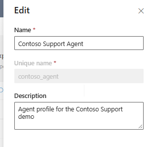
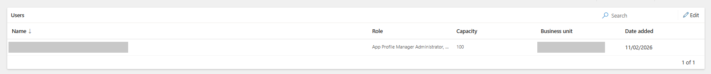
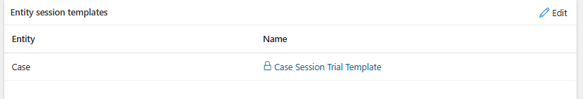
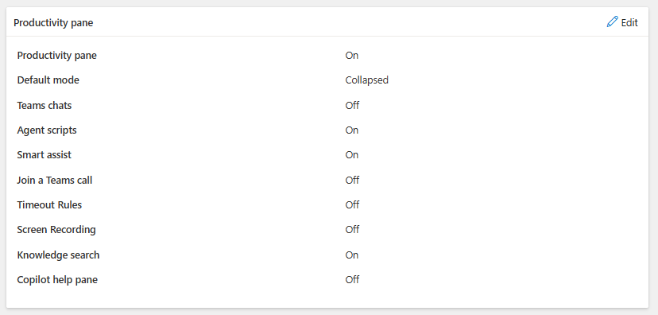
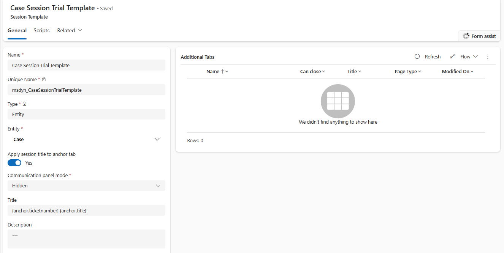
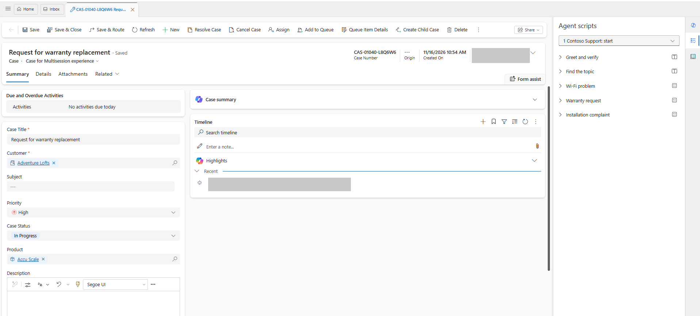

# Customer Service workspace for agents (Contoso Support)

> Draft. Built and tested in a live trial on 2026-11-18. Menu names may differ slightly by release; verify against Microsoft Learn.

## Goal
Give service agents one workspace that opens a case in a session with a readable title and the Productivity pane (Agent scripts, Knowledge search, Smart assist) next to it.

## Prerequisites
- Environment from [01-environment-setup](../01-environment-setup.md).
- Agent scripts from [03-agent-scripts](../03-agent-scripts/README.md) and the session template `Case Session Trial Template`.
- Roles: App Profile Manager Administrator (or System Administrator) to build profiles; agents need Customer Service Representative.

## Design
Three pieces work together:

| Piece | What it does | Where |
|---|---|---|
| Experience profile `Contoso Support Agent` (`contoso_agent`) | Decides which users get which workspace experience, session templates and Productivity pane tools | Copilot Service admin center > Support experience > Workspaces > Experience profiles |
| Session template `Case Session Trial Template` | Decides how a case session looks: title, anchor tab, scripts | Support experience > Workspaces > Session templates |
| Productivity pane | Side panel with Agent scripts, Knowledge search and Smart assist | Part of the experience profile |

## Steps
1. Experience profiles > New. Name `Contoso Support Agent`, Unique name `contoso_agent`, Description `Agent profile for the Contoso Support demo`. Save.
2. Users > Add users: choose the agents. A user can belong to only one profile. A user who is already in another profile is not listed under Available users; remove them from the other profile first, then add them.
3. Entity session templates > Add: entity Case, template `Case Session Trial Template`.
4. Productivity pane > Edit: Productivity pane On, Default mode Expanded, Agent scripts On, Knowledge search On, Smart assist On. Teams chats, Join a Teams call, Timeout Rules, Screen Recording and Copilot help pane stay Off in this demo. Save.
5. Session template `Case Session Trial Template` > General: Title `{anchor.ticketnumber} {anchor.title}`, Apply session title to anchor tab = Yes. Save.
6. Refresh the browser (Ctrl+F5) and open a case in Customer Service workspace.

## Result
Tested on 2026-11-18: a case opens in its own session; the tab shows the ticket number and the case title (long titles are truncated in the tab, for example `CAS-01040-... Requ...`), and the Productivity pane shows the Agent scripts with the root script selected.

## Screenshots
| | |
|---|---|
| Experience profile, name and description |  |
| Users assigned to the profile |  |
| Entity session template |  |
| Productivity pane settings |  |
| Session template with title and anchor tab setting |  |
| Case in the workspace with Agent scripts |  |

## Gotchas
- A user can belong to only one experience profile. If Add users shows "No users found", the user is probably already in another profile (for example a default one): remove them there first. The "Include users without role assignment" box lists users without a role, which is a different problem.
- Default experience profiles cannot be edited; create your own.
- This trial has no "Case handling time" toggle in the Productivity pane list; only the tools in the screenshot are available.
- Session templates are read when the session starts. After changing a template or profile, refresh the browser and reopen the case.
- The Title field uses single braces: `{anchor.ticketnumber}`. Scripts and macros use `${anchor.<attribute>}`.

## Links
- https://learn.microsoft.com/dynamics365/customer-service/administer/create-agent-experience-profile
- https://learn.microsoft.com/dynamics365/customer-service/administer/add-profile-default
- https://learn.microsoft.com/dynamics365/customer-service/administer/configure-session-templates

_Verified on: 2026-11-18 (profile, template and case in a live trial)_
