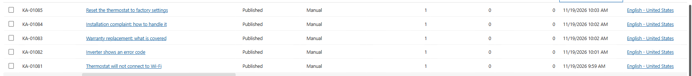
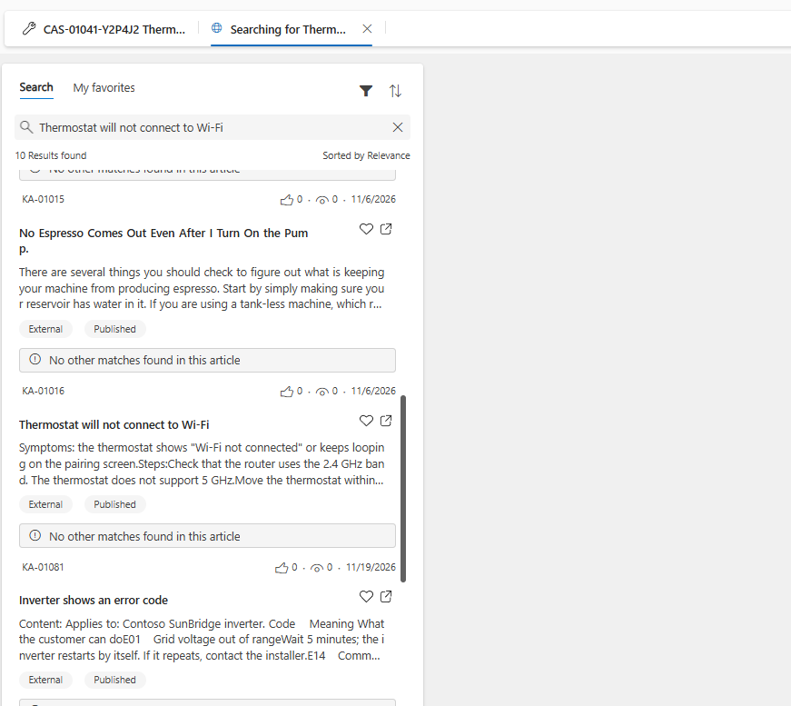
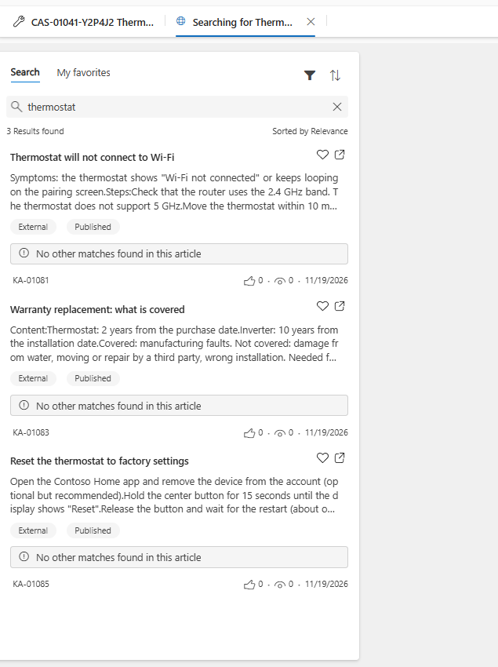
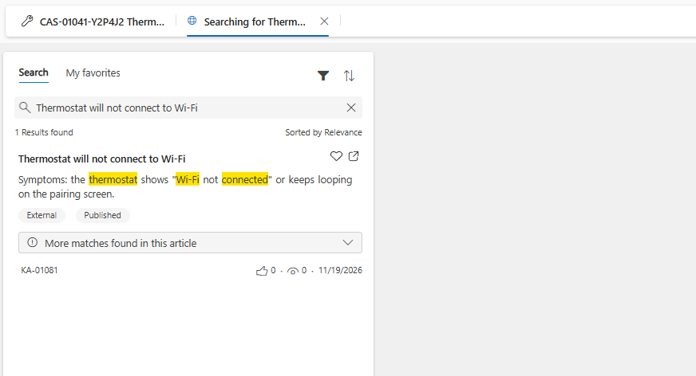

# Knowledge base in Dynamics 365 Customer Service (Contoso Support)

> Draft. Steps are from Microsoft Learn; results from the live trial are added after testing. Menu names may differ slightly by release.

## Goal
Give agents five fictional articles they can find while working on a case: through the Knowledge search pane, the `Search knowledge` macro from [03-agent-scripts](../03-agent-scripts/README.md) and Smart assist.

## Prerequisites
- Environment and workspace from [01-environment-setup](../01-environment-setup.md) and [04-workspace](../04-workspace/README.md): Knowledge search is On in the experience profile.
- Role: Knowledge Manager, Customer Service Manager or Customer Service Representative (Create and Read on the Knowledge Article table).
- Knowledge management enabled: Copilot Service admin center > Support experience > Knowledge management (embedded knowledge search).

## Articles
Five articles, text in [articles.md](articles.md):

| # | Title | Used by |
|---|---|---|
| 1 | Thermostat will not connect to Wi-Fi | Wi-Fi script, Search knowledge macro |
| 2 | Inverter shows an error code | technical cases |
| 3 | Warranty replacement: what is covered | Warranty script |
| 4 | Installation complaint: how to handle it | Installation script |
| 5 | Reset the thermostat to factory settings | Wi-Fi script |

## Steps
1. Copilot Service workspace > Service > Knowledge Articles > New.
2. Content tab: Title, Keywords and the article text from `articles.md` (the rich text editor accepts plain text and tables).
3. Save. Where the article is tied to a product, Relate Product (More > Relate Product).
4. Move the article through the business process: review, approve, then Publish (Finish, Publish now, status Published).
5. Refresh the browser (Ctrl+F5). Open a case whose title contains "Wi-Fi", run the macro `Search knowledge` and check that article 1 is found.

## Result
Tested on 2026-11-19 in the trial: five articles created and published (KA-01081 to KA-01085).
- The `Search knowledge` macro opens a "Searching for ..." tab with the case title as the search string. With the full title ("Thermostat will not connect to Wi-Fi") the sample coffee-machine articles that ship with the trial ranked above our article.
- A short keyword search (`thermostat`) returns only the three relevant articles, with our Wi-Fi article first.
- With "Set search mode as all" = Yes (Support experience > Knowledge > General settings > Knowledge search experience) the same full-title search returns exactly one article, KA-01081, with the matched words highlighted.
- "Enable suggest as you type" showed no suggestions right after it was switched on; to be checked again after indexing.

## Screenshots
| | |
|---|---|
| Published articles |  |
| Macro search with the full case title: sample articles first |  |
| Keyword search `thermostat`: three relevant articles |  |
| Full case title with "Set search mode as all" = Yes: one article |  |

## Gotchas
- Knowledge search uses the logic `searchMode=any` by default: an article matches if it contains any word of the query. A long case title full of common words ("not", "to", "connect") matches many unrelated articles, including the trial's sample articles. Fix: set "Set search mode as all" to Yes (Support experience > Knowledge > General settings > Knowledge search experience). Every word of the query must then match, and the full case title finds only the right article. It needs Dataverse search. Trade-off: a very long or unusual title can find nothing, so keep titles short and the keywords in the articles accurate.
- With the default mode, short keyword queries work better than the full case title; with mode "all" the full title works.
- Only Published articles are found. New articles need a few minutes to be indexed.
- The trial contains sample articles (for example about coffee machines). Unpublish them if they get in the way of the demo.

## Links
- https://learn.microsoft.com/dynamics365/customer-service/use/customer-service-hub-user-guide-knowledge-article
- https://learn.microsoft.com/dynamics365/customer-service/use/publish-ka
- https://learn.microsoft.com/dynamics365/customer-service/administer/set-up-knowledge-management-embedded-knowledge-search
