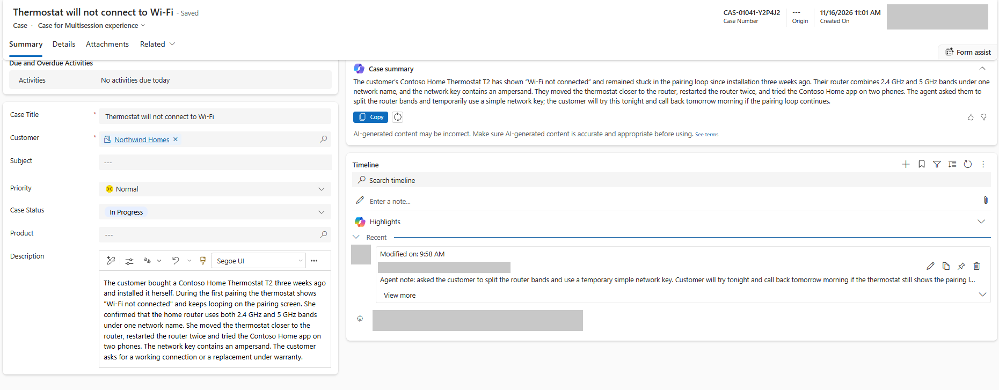
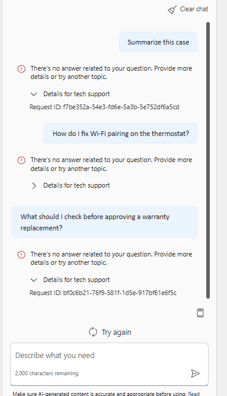

# Copilot features for agents: what works in the trial (Contoso Support)

> Tested on 2026-11-20 in a 30-day Dynamics 365 Customer Service trial with no purchased Copilot Credits. Results can differ by tenant, region and release; verify against Microsoft Learn.

## Goal
Find out which Copilot-based agent features run on the demo environment without paid capacity, so the posts and videos only promise what a reader can reproduce in a trial.

## Summary
| Feature | Where | Result in the trial |
|---|---|---|
| Case summary | Card on the case form | Works |
| Copilot help pane (Ask a question) | Copilot pane next to the case | Opens, but every question returned "There's no answer related to your question" |
| Smart assist | Productivity pane | Not shown on a case record |
| Similar cases | Case > Related > Similar Cases | Not tested yet |

## Case summary
Steps:
1. Copilot Service admin center > Support experience > Productivity > Summaries > Manage: turn on "Make case summaries available to representatives" (opt in to the terms if asked).
2. Fill the case so the source fields hold enough text. Learn: at least 38 English words across the fields Copilot uses (title, description, notes, emails), otherwise no summary is generated.
3. Open the case in Copilot Service workspace and expand the Case summary card.

Result: the summary reproduced the case facts (device, symptoms, what the customer tried, the agent note and the next step). The card offers Copy, Refresh and feedback, and shows the "AI-generated content may be incorrect" notice.

## Copilot help pane (Ask a question)
Steps: Copilot for questions and emails > Ask a question On; in the experience profile the Copilot help pane toggle On; refresh the browser.

Result: the pane opened, but three questions ("Summarize this case", "How do I fix Wi-Fi pairing on the thermostat?", "What should I check before approving a warranty replacement?") all returned "There's no answer related to your question. Provide more details or try another topic." The details for tech support only list a request ID, and there was no message about missing credits. The cause is not established.

## Smart assist
The experience profile has Smart assist On, but no Smart assist tab appears in the Productivity pane on a case. Learn describes Smart assist as suggestions for knowledge articles and similar cases during conversations (chat, voice, SMS); the productivity-tools page says it works across channels "except entity records". So on a case record the effect is expected, not a setup error.

## Gotchas
- Case summary needs enough text in the case fields (about 38 English words); cases with an empty description get no summary.
- A working Case summary does not mean the Copilot help pane works: the two are separate settings and the pane returned no answers here.
- Smart assist is for conversations, not for case forms.
- Do not promise these features to readers without checking licences and capacity in their own tenant.

## Links
- https://learn.microsoft.com/dynamics365/customer-service/use/copilot-use-summary
- https://learn.microsoft.com/dynamics365/contact-center/administer/copilot-enable-summary
- https://learn.microsoft.com/dynamics365/customer-service/administer/configure-copilot-features
- https://learn.microsoft.com/dynamics365/customer-service/use/oc-view-ai-suggested-cases-articles
- https://learn.microsoft.com/dynamics365/customer-service/administer/productivity-tools

_Verified on: 2026-11-20 (live trial; Learn pages above)_
