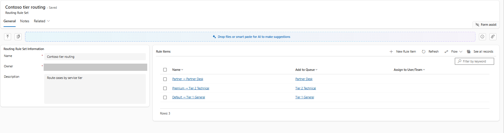
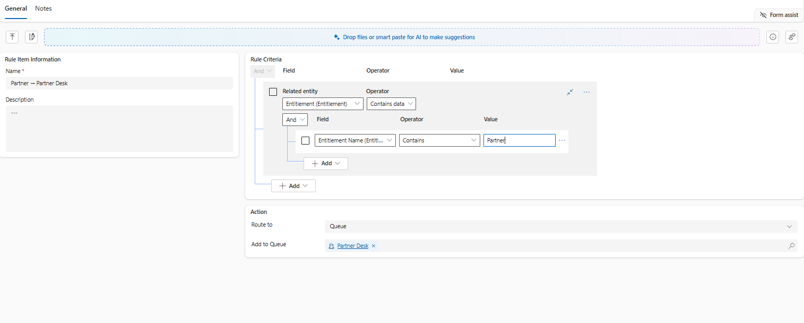
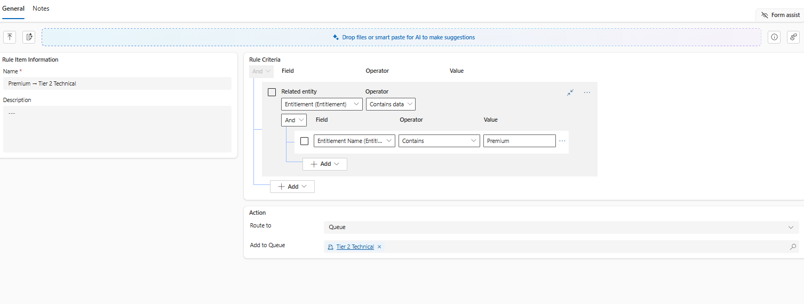
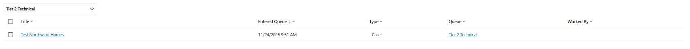
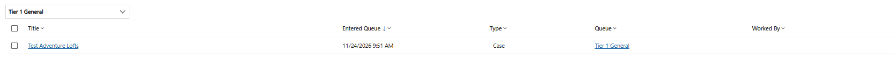
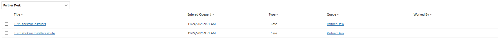

# Queues and case routing (Contoso Support)

> Draft. Built and tested in a live trial on 2026-11-24. Menu names may differ slightly by release; verify against Microsoft Learn.

## Goal
Send every new case to the queue that matches its service tier, so Partner cases reach the Partner Desk and Standard cases land in the general queue.

## Prerequisites
- SLA entitlements from [02-sla](../02-sla/README.md): the case has an Entitlement (Standard, Premium or Partner) selected. The routing rules read the entitlement name.
- Role: Customer Service Manager, System Administrator or System Customizer.
- Unified routing turned off for records (see Gotchas) or, if you use unified routing, workstreams instead of the rule set below.

## Design
Three basic queues from the scenario and one basic routing rule set; the rule items are evaluated from top to bottom and the first match wins.

| Order | Rule item | Condition | Route to |
|---|---|---|---|
| 1 | Partner -> Partner Desk | Related entity Entitlement contains data; Entitlement Name contains `Partner` | Queue `Partner Desk` |
| 2 | Premium -> Tier 2 Technical | Related entity Entitlement contains data; Entitlement Name contains `Premium` | Queue `Tier 2 Technical` |
| 3 | Default -> Tier 1 General | none | Queue `Tier 1 General` |

Mapping Premium to Tier 2 Technical is a choice made for this demo. The scenario defines the three queues but not which tier uses which.

## Steps
1. Copilot Service admin center > Customer support > Queues > Basic queues > New: `Tier 1 General`, `Tier 2 Technical`, `Partner Desk` (type Public).
2. Customer support > Routing > Basic routing rule sets > New: Name `Contoso tier routing`, Description `Route cases by service tier`. Save.
3. Rule Items > New Rule Item, three times, as in the table. In Rule Criteria use "Add related entity" > Entitlement, then the field Entitlement Name with the operator Contains. Action: Route to Queue, then the queue. Save & Close each.
4. Activate the rule set. Only one basic rule set can be active at a time.
5. Create or open a case with the entitlement selected and choose Save & Route.

## Result
Tested on 2026-11-24: after Save & Route the test cases appeared in the queues Tier 2 Technical, Tier 1 General and Partner Desk (the Queue items view of each queue). It did not work until unified routing was turned off.

## Screenshots
| | |
|---|---|
| Rule set with three rule items |  |
| Rule item Partner -> Partner Desk |  |
| Rule item Premium -> Tier 2 Technical |  |
| Queue items: Tier 2 Technical |  |
| Queue items: Tier 1 General |  |
| Queue items: Partner Desk |  |

## Gotchas
- With unified routing enabled, Save & Route goes through unified routing (workstreams, advanced queues), not through the basic rule set, and the cases are not routed by the rules. In this trial that was the cause of "nothing happens". Microsoft recommends unified routing for new setups; the basic rule set is the simple option for a demo.
- Only one basic routing rule set can be active at a time, and an active rule set must be deactivated before you edit it.
- Save & Route applies the rule set when a case is saved and routed. For existing cases use Apply Routing Rule in the Customer Service Hub.
- The rule reads the Entitlement on the case, and the entitlement is not filled in automatically (see [02-sla](../02-sla/README.md)). A case without an entitlement falls through to the Default rule.
- For lookup fields only equal, not equal, null and not null are supported; use a text field of the related entity, such as Entitlement Name, for Contains.
- Rule items point to queues that are not solution-aware: after moving the solution to another environment, edit the queue in each rule item.

## Links
- https://learn.microsoft.com/dynamics365/customer-service/administer/create-rules-automatically-route-cases
- https://learn.microsoft.com/dynamics365/customer-service/administer/set-up-queues-manage-activities-cases
- https://learn.microsoft.com/dynamics365/customer-service/administer/overview-unified-routing

_Verified on: 2026-11-24 (live trial; Learn pages above)_
